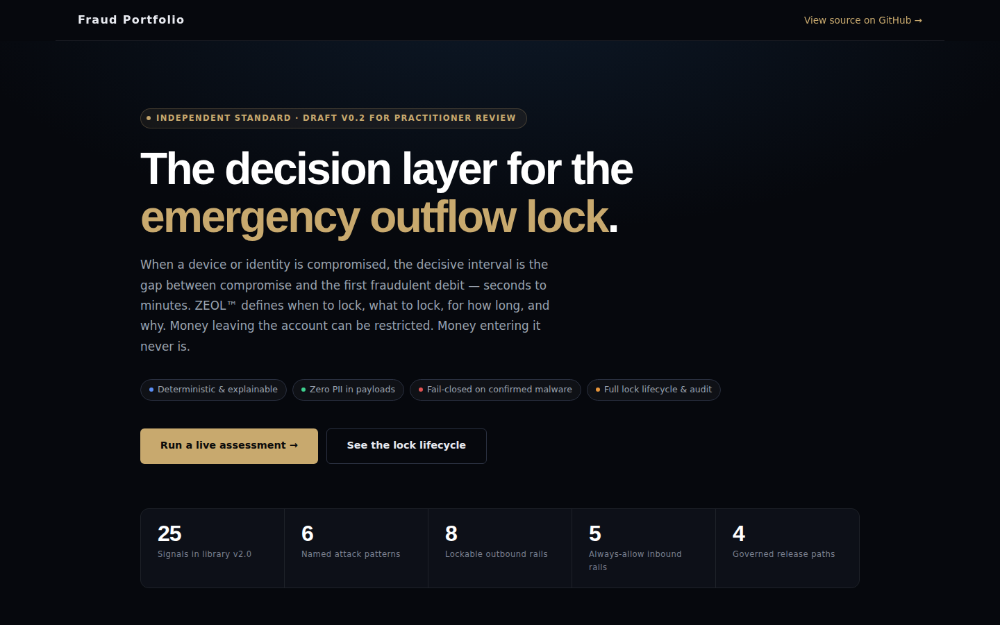

# Emergency Outflow Lock

**Status:** v0.2 reference implementation, signal library v2.0.0 · Independent open-source project

**Documentation:** [LICENSE](./LICENSE)

Maintained by **Gururaj G J** — Senior Fraud Risk | Merchant Risk | Financial Crime Professional
[LinkedIn](https://www.linkedin.com/in/gururaj-gj-52a062b4/) · [GitHub](https://github.com/Gururaj-GJ-G)

---

## What it is

A decision standard for compromise-triggered outflow restriction in digital payments — designed
to lock fund movement automatically the moment a device or account shows strong signs of
compromise, rather than relying solely on the user to notice and act.

- Named combination patterns (`PAT-ATO-1` … `PAT-MULE-1`)
- A split critical-override system: standalone fail-closed signals (e.g. trojan or malware
  detection) that trigger an immediate lock on their own, and corroborated-critical signals
  (e.g. emulator or SIM-swap indicators) that require a second signal before forcing an
  emergency lock
- A full lock lifecycle state machine with TTL, governed release, and an append-only audit trail
- A **25-signal** versioned signal library (`zeol_signals.json`)

## Screenshot

## Why this exists

This addresses a specific gap identified in regulatory discussion around digital payment
safeguards: user-triggered controls (like "freeze my card" buttons) fail when the device itself
is already compromised, because the attacker — not the legitimate user — is the one holding the
session. This standard is designed for that scenario specifically.

## Architecture

A Python reference engine with a FastAPI service layer (API-key auth, idempotency keys), plus an
interactive in-browser assessor that runs the same decision logic client-side. Both
implementations were verified against each other across 9 test cases (5 proof-of-concept
scenarios plus lifecycle edge cases) with matching results.

## Regulatory context

Cites publicly reported figures on digital payment fraud volumes from India's National Cybercrime
Reporting Portal (NCRP) for context, with a clear disclaimer that this project is independent and
not endorsed by or affiliated with any regulator.

## Use cases

Digital payment platforms and banks evaluating a compromise-triggered (rather than purely
user-triggered) outflow-restriction mechanism as part of their fraud-response toolkit.

## License

MIT — see [LICENSE](./LICENSE).
